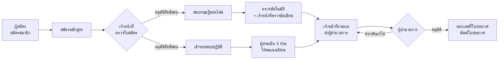

# TMRDA — ระบบบริหารการฝึกอบรมและทดสอบมาตรฐานฝีมือแรงงาน

ระบบครบวงจรตั้งแต่ **สมัครสมาชิก → สมัครหลักสูตร → สอบทฤษฎีออนไลน์ → ประเมินภาคปฏิบัติโดยผู้ประเมิน 3 ท่าน → ผู้อำนวยการอนุมัติผล → พิมพ์ใบประกาศนียบัตร**
สร้างด้วย Next.js 14 (App Router) + Supabase (PostgreSQL)

---

## สารบัญ

1. [ภาพรวมการทำงาน](#ภาพรวมการทำงาน)
2. [ความสามารถตามบทบาท](#ความสามารถตามบทบาท)
3. [กติกาการคิดคะแนน](#กติกาการคิดคะแนน)
4. [เริ่มต้นใช้งาน (ติดตั้ง)](#เริ่มต้นใช้งาน)
5. [บัญชีสำหรับทดสอบ](#บัญชีสำหรับทดสอบ)
6. [สถานการณ์ทดสอบแนะนำ](#สถานการณ์ทดสอบแนะนำ)
7. [โครงสร้างโปรเจกต์](#โครงสร้างโปรเจกต์)
8. [ฐานข้อมูล](#ฐานข้อมูล)
9. [ความปลอดภัย และข้อจำกัดที่ควรรู้](#ความปลอดภัย-และข้อจำกัดที่ควรรู้)
10. [Deploy และการดูแลระบบ](#deploy-และการดูแลระบบ)

---

## ภาพรวมการทำงาน



| ขั้น | ใครทำ | ทำที่ไหน |
| --- | --- | --- |
| สมัครสมาชิก (4 ขั้นตอน ตรวจเลขบัตรประชาชนด้วย checksum) | ผู้สมัคร | `/register` |
| สมัครหลักสูตร / พิมพ์ใบสมัครทางการ (A4) | ผู้สมัคร | `/courses`, `/print/application` |
| ตรวจใบสมัคร อนุมัติสิทธิ์สอบ จัดเข้ารอบปฏิบัติ | เจ้าหน้าที่ | `/admin/courses/[id]` แท็บ “ผู้สมัคร” |
| สร้างชุดข้อสอบทฤษฎี / แบบประเมินปฏิบัติ | เจ้าหน้าที่ | `/admin/exams/[id]` |
| สร้างรอบสอบปฏิบัติ + กำหนดผู้ประเมิน (สูงสุด 3 ท่าน/รอบ) | เจ้าหน้าที่ | `/admin/courses/[id]` แท็บ “ภาคปฏิบัติ” |
| สอบทฤษฎี (จับเวลา บันทึกอัตโนมัติ) | ผู้สมัคร | `/exam/[attemptId]` |
| ให้คะแนนภาคปฏิบัติ | ผู้ประเมิน | `/evaluate` |
| ตรวจข้อเขียน รวมผล ส่งอนุมัติ | เจ้าหน้าที่ | `/admin/results` |
| อนุมัติ / ส่งกลับ | ผู้อำนวยการ | `/approvals` |
| พิมพ์ใบประกาศนียบัตร (A4 แนวนอน) | ผู้สมัคร / เจ้าหน้าที่ / ผอ. | `/print/certificate/[applicationId]` |

---

## ความสามารถตามบทบาท

ระบบมี 4 บทบาท (`users.role`) เมนูและสิทธิ์จะเปลี่ยนตามบทบาทอัตโนมัติ

### ผู้สมัคร (`user`)
- สมัครสมาชิกแบบ wizard 4 ขั้นตอน: ข้อมูลบุคคล → บัญชีและการติดต่อ → ที่อยู่ (จังหวัด/อำเภอ/ตำบล 77 จังหวัด เติมรหัสไปรษณีย์อัตโนมัติ) → การศึกษาและตรวจทาน
- หน้าหลักแสดง “เส้นทาง” ของแต่ละหลักสูตร ว่าอยู่ขั้นไหนและต้องทำอะไรต่อ
- สมัคร/ถอนการสมัครหลักสูตร พิมพ์ใบสมัครทางการของกรมพัฒนาฝีมือแรงงานจากข้อมูลจริง
- ทำข้อสอบทฤษฎีแบบเต็มจอ: นับถอยหลังจากเวลาฝั่งเซิร์ฟเวอร์, บันทึกคำตอบอัตโนมัติ (ปิดเบราว์เซอร์แล้วกลับมาทำต่อได้), แผงเลขข้อ, ปักธงข้อที่ยังไม่แน่ใจ, ใช้คีย์บอร์ดได้ (← → เปลี่ยนข้อ, 1–9 เลือกคำตอบ, F ปักธง), ส่งอัตโนมัติเมื่อหมดเวลา (ถ้าเน็ตหลุดจะล็อกหน้าจอและลองส่งซ้ำให้เอง) · ถ้าออกจากหน้าสอบไปจนหมดเวลา ระบบจะตรวจจากคำตอบที่บันทึกไว้ให้อัตโนมัติ
- ดูผลสอบ เฉลย (ถ้าเปิดให้ดู) และพิมพ์ใบประกาศเมื่อผู้อำนวยการอนุมัติ
- แก้ไขข้อมูลส่วนตัว อัปโหลดเอกสาร (บัตรประชาชน วุฒิการศึกษา รูปถ่าย) และประวัติแรงงาน

### เจ้าหน้าที่ / ผู้ดูแลระบบ (`admin`)
- ภาพรวมงานค้าง: ใบสมัครรอตรวจ ข้อเขียนรอตรวจ รอบปฏิบัติที่คะแนนยังไม่ครบ รายการรอ ผอ.
- จัดการหลักสูตร และ “ศูนย์กลางหลักสูตร” รวมผู้สมัคร ข้อสอบ รอบปฏิบัติไว้ในที่เดียว
- **ตัวสร้างข้อสอบทฤษฎี** 6 รูปแบบ พร้อมตรวจความถูกต้องก่อนบันทึก ตั้งเวลาเปิด–ปิดสอบ จำนวนครั้งที่สอบได้ สุ่มลำดับข้อ/ตัวเลือก และเลือกได้ว่าจะให้ผู้สอบเห็นเฉลยหรือไม่
- **ตัวสร้างแบบประเมินปฏิบัติ** แบบลำดับชั้นสูงสุด 4 ระดับ (หมวดหลัก → หัวข้อย่อย → รายการประเมิน → เกณฑ์ย่อย) คะแนนเต็มของหัวข้อแม่คำนวณจากข้อย่อยอัตโนมัติ
- สร้างรอบสอบปฏิบัติ กำหนดผู้ประเมิน **สูงสุด 3 ท่านต่อรอบ** และจัดผู้สมัครเข้ารอบ ติดตามความคืบหน้าการให้คะแนนของผู้ประเมินแต่ละท่าน
- ตรวจข้อเขียน รวมผลคะแนน ส่งผู้อำนวยการอนุมัติ (ดึงกลับมาแก้ได้ก่อน ผอ. ตัดสิน) ส่งออก CSV
- จัดการสมาชิก สร้างบัญชีเจ้าหน้าที่/ผู้ประเมิน/ผู้อำนวยการ เปลี่ยนสิทธิ์ ระงับบัญชี รีเซ็ตรหัสผ่าน

### ผู้ประเมิน (`evaluator`)
- เห็นเฉพาะรอบที่ได้รับมอบหมาย
- ใบให้คะแนนตามเกณฑ์ ใส่คะแนนที่ข้อย่อยระดับล่างสุด ระบบรวมคะแนนแต่ละหมวดให้ทันที
- บันทึกร่างอัตโนมัติ ส่งคะแนนได้เมื่อให้ครบทุกข้อ แก้ไขได้จนกว่าผลจะถูกส่งให้ ผอ.
- ไม่เห็นคะแนนของผู้ประเมินท่านอื่น (ประเมินอิสระ)

### ผู้อำนวยการ (`director`)
- รายการรออนุมัติแยกตามหลักสูตร พร้อมรายละเอียดคะแนนทฤษฎี/ปฏิบัติ และคะแนนจากผู้ประเมินแต่ละท่าน
- อนุมัติทีละคนหรือหลายคนพร้อมกัน — ระบบ **ออกเลขที่ใบประกาศอัตโนมัติ** (`TMRDA-<ปี พ.ศ.>-<เลขที่>`) และใช้ชื่อ–ตำแหน่งของผู้อนุมัติบนใบประกาศ
- ส่งกลับแก้ไขพร้อมเหตุผล
- ดูรายชื่อใบประกาศที่ออกแล้วและพิมพ์ซ้ำได้

> ผู้อำนวยการและเจ้าหน้าที่สามารถถูกกำหนดเป็นผู้ประเมินในรอบปฏิบัติได้ด้วย (เมนู “งานประเมินของฉัน”)

---

## กติกาการคิดคะแนน

กติกาทั้งหมดอยู่ใน [`lib/scoring.ts`](lib/scoring.ts) และมีชุดทดสอบใน [`tests/scoring.test.mjs`](tests/scoring.test.mjs)

### ภาคทฤษฎี — 6 รูปแบบคำถาม

| รูปแบบ | การตรวจ |
| --- | --- |
| ตัวเลือกเดียว | ถูกได้เต็ม ผิดได้ 0 |
| หลายคำตอบ | ค่าเริ่มต้น: ต้องเลือกถูกครบและไม่เลือกข้อผิด จึงได้คะแนนเต็ม · เปิด “คะแนนบางส่วน” ได้: (ข้อถูกที่เลือก − ข้อผิดที่เลือก) ÷ จำนวนข้อถูก (ไม่ต่ำกว่า 0) |
| ถูก / ผิด | แยก “ตอบผิด” กับ “ไม่ได้ตอบ” ชัดเจน |
| จับคู่ | คิดตามสัดส่วนคู่ที่ถูก จับคู่ด้วยรหัสคู่ (ข้อความฝั่งขวาซ้ำกันได้โดยไม่ทำให้ตรวจผิด) |
| เติมคำตอบสั้น | เทียบกับรายการคำตอบที่ยอมรับ ไม่สนตัวพิมพ์เล็ก/ใหญ่และช่องว่างเกิน |
| อัตนัย / ข้อเขียน | เจ้าหน้าที่ตรวจให้คะแนนเอง ระหว่างรอตรวจผลจะเป็น “รอผล” (ข้อเขียนที่ไม่ได้ตอบได้ 0 ทันที) |

- ผ่านเมื่อ `คะแนน ÷ คะแนนเต็ม × 100 ≥ เกณฑ์ผ่าน (%)`
- ข้อสอบของแต่ละคนถูก “แช่แข็ง” ตอนเริ่มสอบ (รวมลำดับที่สุ่มแล้ว) การแก้ข้อสอบภายหลังจึงไม่กระทบคนที่กำลังสอบ
- ถ้าหลักสูตรมีข้อสอบทฤษฎีหลายชุด ผู้สอบแต่ละคนจะได้รับ **1 ชุดแบบสุ่ม** (เมื่อเริ่มทำแล้วจะได้ชุดเดิมทุกครั้ง) จำนวนครั้งที่สอบได้นับตามชุดนั้น
- ถ้าสอบได้หลายครั้ง ระบบใช้ครั้งที่ดีที่สุด: ถ้ามีครั้งที่ตรวจเสร็จและผ่าน ใช้ครั้งที่ % สูงสุด · ถ้ายังไม่มีครั้งที่ผ่านแต่มีครั้งที่รอตรวจข้อเขียน จะรอผลครั้งนั้นก่อน · นอกนั้นใช้ครั้งที่ % สูงสุด

### ภาคปฏิบัติ — ผู้ประเมิน 3 ท่าน

```
คะแนนภาคปฏิบัติ = (คะแนนผู้ประเมินท่านที่ 1 + ท่านที่ 2 + ท่านที่ 3) ÷ 3
```

- แต่ละท่านให้คะแนนอิสระตามเกณฑ์เดียวกัน คะแนนรวมของแต่ละท่าน = ผลรวมคะแนนข้อย่อยระดับล่างสุด
- ผลภาคปฏิบัติจะ “ครบ” เมื่อผู้ประเมิน **ทุกท่านที่ได้รับมอบหมาย** ส่งคะแนนแล้ว (ถ้ารอบนั้นกำหนดผู้ประเมินไว้น้อยกว่า 3 ท่าน จะหารด้วยจำนวนท่านที่กำหนด)

### ผลรวมของหลักสูตร

- หลักสูตรที่มีทั้งทฤษฎีและปฏิบัติ: **ต้องผ่านทั้งสองภาค**
- มีภาคเดียว: ผ่านภาคนั้นก็ผ่าน
- ภาคใดไม่ผ่านแล้ว ผลรวม = ไม่ผ่านทันที (ไม่ต้องรออีกภาค)
- ส่งให้ ผอ. ได้เฉพาะผู้ที่ผลพร้อมแล้ว ค่าคะแนนที่ส่งจะถูกบันทึกเป็น “ผลทางการ” ไว้ที่ใบสมัคร ใบประกาศใช้ค่านี้

---

## เริ่มต้นใช้งาน

### สิ่งที่ต้องมี
- Node.js 20 ขึ้นไป (ชุดทดสอบใช้ Node 22.6+)
- โปรเจกต์ Supabase

### 1) ติดตั้งและตั้งค่า

```bash
npm install
cp .env.example .env      # ใส่ NEXT_PUBLIC_SUPABASE_URL และ NEXT_PUBLIC_SUPABASE_ANON_KEY
```

### 2) เตรียมฐานข้อมูล (Supabase → SQL Editor)

| กรณี | ไฟล์ที่ต้องรัน ตามลำดับ |
| --- | --- |
| ฐานข้อมูลเดิมของ TMRDA (มีข้อมูลอยู่แล้ว) | `supabase/migrations/001_tmrda_v2.sql` → `supabase/seed/002_test_data.sql` (ถ้าต้องการข้อมูลทดสอบ) |
| โปรเจกต์ Supabase ใหม่ | `supabase/schema.sql` → `001_tmrda_v2.sql` → `002_test_data.sql` |

- `001_tmrda_v2.sql` รันซ้ำได้อย่างปลอดภัย (idempotent) จะเพิ่มบทบาทผู้ใช้, เข้ารหัสรหัสผ่านเดิมทั้งหมดด้วย bcrypt, ตารางรอบสอบ/คะแนนผู้ประเมิน/การสอบ, ขั้นตอนอนุมัติ, bucket สำหรับเอกสาร และบัญชีเจ้าหน้าที่สำหรับทดสอบ
- `002_test_data.sql` สร้างข้อมูลทดสอบจริงในฐานข้อมูล (ไม่ใช่ข้อมูลจำลองในหน้าจอ) และจะข้ามถ้าเคยรันแล้ว
- ⚠️ `schema.sql` **ลบตารางทั้งหมดแล้วสร้างใหม่** ใช้กับโปรเจกต์ใหม่เท่านั้น

> ถ้ายังไม่ได้รัน migration หน้าเข้าสู่ระบบจะแสดงคำเตือนให้ทราบ

### 3) รัน

```bash
npm run dev         # http://localhost:3000
npm test            # ทดสอบกติกาการคิดคะแนน
npm run typecheck   # ตรวจ TypeScript
npm run build       # build production
```

---

## บัญชีสำหรับทดสอบ

มีหลังจากรัน migration และ seed — **เปลี่ยนรหัสผ่าน/ระงับบัญชีเหล่านี้ก่อนใช้งานจริง** (เมนูมุมขวาบน → เปลี่ยนรหัสผ่าน หรือหน้า “สมาชิกและสิทธิ์”)

| บทบาท | เลขบัตรประชาชน | อีเมล | รหัสผ่าน |
| --- | --- | --- | --- |
| เจ้าหน้าที่ (admin) | 1111111111111 | admin@tmrda.com | `admin123` |
| ผู้อำนวยการ | 3333333333333 | director@tmrda.com | `director123` |
| ผู้ประเมินท่านที่ 1 | 4444444444441 | evaluator1@tmrda.com | `evaluator123` |
| ผู้ประเมินท่านที่ 2 | 4444444444442 | evaluator2@tmrda.com | `evaluator123` |
| ผู้ประเมินท่านที่ 3 | 4444444444443 | evaluator3@tmrda.com | `evaluator123` |
| ผู้สมัคร (บัญชีเดิม) | 1234567890123 | somchai@example.com | `user123` |
| ผู้สมัคร — สอบผ่านทั้ง 2 ภาค | 1101700230708 | anucha.test@tmrda.com | `test1234` |
| ผู้สมัคร — ข้อเขียนรอตรวจ, ผู้ประเมินส่ง 2/3 | 3100400123456 | pimchanok.test@tmrda.com | `test1234` |
| ผู้สมัคร — ทฤษฎีไม่ผ่าน | 1509900456789 | thanakorn.test@tmrda.com | `test1234` |
| ผู้สมัคร — ยังไม่ได้สอบ | 3401200789017 | wanna.test@tmrda.com | `test1234` |
| ผู้สมัคร — ใบสมัครรอตรวจ | 5100300567898 | kittipat.test@tmrda.com | `test1234` |

> รหัสผ่านของบัญชีเดิมที่ไม่มีรหัส จะถูกตั้งเป็น `password123`
> ตั้ง `NEXT_PUBLIC_SHOW_DEMO_ACCOUNTS=true` เพื่อแสดงปุ่มกรอกบัญชีทดสอบบนหน้าเข้าสู่ระบบ (ใช้เฉพาะเครื่องพัฒนา/ทดสอบ)

---

## สถานการณ์ทดสอบแนะนำ

ใช้ข้อมูลจาก seed หลักสูตร **“ช่างเชื่อมไฟฟ้า ระดับ 1”** ทดสอบได้ครบทุกขั้นภายใน ~10 นาที

1. **ผู้สมัครทำข้อสอบ** — เข้าด้วย `3401200789017` → “หลักสูตรและการสอบ” → เริ่มทำข้อสอบ (มีครบ 6 รูปแบบ) → ลองปิดแท็บแล้วเปิดใหม่ คำตอบยังอยู่ → ส่ง → ดูผลและเฉลย
2. **เจ้าหน้าที่ตรวจใบสมัคร** — เข้าด้วย admin → หลักสูตร → ช่างเชื่อมไฟฟ้า → แท็บผู้สมัคร → อนุมัติ “กิตติพัฒน์” และจัดเข้ารอบที่ 1
3. **เจ้าหน้าที่ตรวจข้อเขียน** — “ผลคะแนนและส่งอนุมัติ” → แถวของ “พิมพ์ชนก” → ตรวจข้อเขียน
4. **ผู้ประเมินท่านที่ 3 ให้คะแนน** — เข้าด้วย `4444444444443` → งานประเมิน → รอบที่ 1 → ให้คะแนน “พิมพ์ชนก” และ “วรรณา” แล้วส่ง (คะแนนปฏิบัติของพิมพ์ชนกจะครบ 3/3 และหาร 3 อัตโนมัติ)
5. **ส่งอนุมัติ** — admin → ผลคะแนน → เลือก อนุชา, ธนากร, พิมพ์ชนก → ส่งผู้อำนวยการ
6. **ผู้อำนวยการอนุมัติ** — เข้าด้วย `3333333333333` → อนุมัติ → ระบบออกเลขที่ใบประกาศให้ผู้ที่ผ่าน
7. **พิมพ์ใบประกาศ** — เข้าด้วย `1101700230708` → ผลสอบและใบประกาศ → พิมพ์ใบประกาศ (หรือบันทึกเป็น PDF)

---

## โครงสร้างโปรเจกต์

```
app/
  (auth)/login, register          หน้าเข้าสู่ระบบ / สมัครสมาชิก
  (app)/                          ทุกหน้าที่ต้องเข้าสู่ระบบ (มีแถบเมนูด้านข้าง)
    dashboard, courses, results, profile        ผู้สมัคร
    admin/                                      เจ้าหน้าที่
      courses/[id]    ศูนย์กลางหลักสูตร (ผู้สมัคร · ข้อสอบ · รอบปฏิบัติ)
      exams/[formId]  ตัวสร้างข้อสอบทฤษฎี / แบบประเมินปฏิบัติ ('new' = สร้างใหม่)
      results         ตรวจข้อเขียน รวมผล ส่งอนุมัติ
      users           สมาชิกและสิทธิ์
    evaluate/[roundId]                          ผู้ประเมิน
    approvals, approvals/issued                 ผู้อำนวยการ
  exam/[attemptId]                หน้าสอบแบบเต็มจอ
  print/application, certificate  เอกสารสำหรับพิมพ์ (A4)
  api/keep-alive                  ping ฐานข้อมูลไม่ให้ Supabase หยุดทำงาน
components/
  ui/                             ชุด UI กลาง (Button, Field, Dialog, Table, Tabs …)
  AppShell.tsx                    เลย์เอาต์และเมนูตามบทบาท
  student/ admin/ results/ evaluate/ print/   ส่วนประกอบเฉพาะแต่ละส่วน
lib/
  api.ts          ชั้นเข้าถึงข้อมูล — ทุกการอ่าน/เขียน Supabase ผ่านไฟล์นี้
  auth.tsx        session, การเข้าสู่ระบบ, การป้องกันหน้าตามบทบาท
  scoring.ts      กติกาการคิดคะแนนทั้งหมด (pure functions)
  results.ts      รวมผลคะแนนรายหลักสูตร
  format.ts       วันที่ไทย (พ.ศ.), ชื่อ, เลขบัตร, ข้อความ error ภาษาไทย
  constants.ts    ตัวเลือกต่าง ๆ (คำนำหน้า วุฒิการศึกษา สถานภาพแรงงาน …)
  types.ts        type ของข้อมูลทั้งหมด
public/data/thai-locations.json   จังหวัด/อำเภอ/ตำบล/รหัสไปรษณีย์ (โหลดเมื่อใช้)
supabase/
  schema.sql                      โครงสร้างตั้งต้น (โปรเจกต์ใหม่เท่านั้น)
  migrations/001_tmrda_v2.sql     อัปเกรดเป็น v2
  seed/002_test_data.sql          ข้อมูลทดสอบ
tests/scoring.test.mjs            ชุดทดสอบการคิดคะแนน
```

**แนวทางการพัฒนาต่อ**
- อ่าน/เขียนข้อมูลผ่าน `lib/api.ts` เท่านั้น และแสดง error ด้วย `errorMessage()` เพื่อให้ข้อความเป็นภาษาไทยที่ผู้ใช้เข้าใจ
- กติกาคะแนนใหม่ให้เพิ่มใน `lib/scoring.ts` พร้อมเพิ่ม test
- ใช้ส่วนประกอบใน `components/ui` เพื่อให้หน้าตาสม่ำเสมอ สีหลักคือ `brand-600` (#dc2626)
- ไม่มีข้อมูลจำลองในหน้าจอ — ถ้าไม่มีข้อมูลให้แสดง EmptyState

---

## ฐานข้อมูล

| ตาราง | ใช้เก็บ |
| --- | --- |
| `users` | สมาชิกทุกบทบาท (`role`), ข้อมูลส่วนตัว ที่อยู่ เอกสาร, `password_hash` (bcrypt) |
| `sessions` | token การเข้าสู่ระบบ (อายุ 30 วัน) |
| `training` | หลักสูตร |
| `apply_training` | ใบสมัคร + สถานะสิทธิ์สอบ + ผลทางการ + สถานะอนุมัติ + เลขที่ใบประกาศ |
| `histories_labor` | ประวัติสถานภาพแรงงาน |
| `test_form` | ชุดข้อสอบ (`exam_type` = theory/practical, `questions`, `practical_items` เป็น JSONB) |
| `exam_attempts` | การสอบทฤษฎีแต่ละครั้ง (ชุดคำถามที่แช่แข็ง, คำตอบ, คะแนน, เส้นตาย) |
| `practical_rounds` | รอบสอบปฏิบัติ (`evaluator_ids` สูงสุด 3) |
| `practical_scores` | คะแนนของผู้ประเมินแต่ละท่าน ต่อผู้สมัคร ต่อรอบ |

ฟังก์ชันฝั่งฐานข้อมูล (SECURITY DEFINER): `tmrda_login`, `tmrda_register`, `tmrda_session`, `tmrda_logout`, `tmrda_change_password`, `tmrda_admin_save_user`, `tmrda_submit_results`, `tmrda_recall_results`, `tmrda_decide_results`

---

## ความปลอดภัย และข้อจำกัดที่ควรรู้

สิ่งที่ปรับปรุงจากเวอร์ชันเดิม
- เดิมระบบ **ไม่ตรวจรหัสผ่าน** และสร้างบัญชีให้อัตโนมัติเมื่อกรอกเลขใดก็ได้ — ตอนนี้ตรวจรหัสผ่านจริงด้วย bcrypt ในฐานข้อมูล
- เดิมรหัสผ่านเก็บเป็นข้อความธรรมดาและ **ใครก็อ่านได้** ผ่าน API — ตอนนี้คอลัมน์ `password_hash` ถูกปิดไม่ให้เบราว์เซอร์อ่าน
- การเปลี่ยนบทบาท/สิทธิ์ การส่งผล การอนุมัติ และการออกเลขที่ใบประกาศ ทำได้เฉพาะผ่านฟังก์ชันในฐานข้อมูลที่ตรวจ session และบทบาทของผู้ทำรายการ
- เดิมข้อสอบปฏิบัติถูกบันทึกเป็นข้อสอบทฤษฎี และคะแนนสอบไม่ถูกบันทึกเลย (คอลัมน์ไม่มีอยู่จริง) — แก้แล้ว
- เอกสารแนบเก็บใน Supabase Storage จริง (เดิมถ้าอัปโหลดไม่ได้จะเก็บไว้ในเบราว์เซอร์เครื่องเดียว)
- กติกาการสอบบังคับที่ฐานข้อมูล (trigger `tmrda_attempt_guard`): เวลาสิ้นสุดคำนวณจากนาฬิกาเซิร์ฟเวอร์, เริ่มสอบได้เฉพาะผู้ที่ได้รับสิทธิ์และอยู่ในช่วงเวลาเปิดสอบ, จำกัดจำนวนครั้งและห้ามสอบซ้อน, ชุดคำถามที่แช่แข็งแก้ไม่ได้, ส่งคำตอบหลังหมดเวลา (เกิน 2 นาที) ไม่ได้ — ระบบจะตรวจจากคำตอบที่บันทึกไว้ก่อนหมดเวลา
- เฉลยจะแสดงให้ผู้สอบเห็นเมื่อใช้สิทธิ์สอบครบหรือปิดรอบสอบแล้วเท่านั้น (กันการดูเฉลยแล้วสอบซ้ำ)

ข้อจำกัดที่ยังมี (แนะนำสำหรับเฟสถัดไป)
- ระบบยังใช้ anon key ฝั่งเบราว์เซอร์ ตารางทั่วไป (หลักสูตร ข้อสอบ คะแนนผู้ประเมิน) ยังเปิดให้เขียนได้ด้วย anon key หากผู้ไม่หวังดีเรียก API ตรง — ถ้าต้องการความปลอดภัยระดับสูง ควรย้ายไปใช้ Supabase Auth + RLS ตามบทบาท หรือย้ายการเขียนไป API route ฝั่งเซิร์ฟเวอร์ที่ใช้ service role key
- การคำนวณคะแนนทฤษฎีทำฝั่งเบราว์เซอร์ และเฉลยอยู่ในข้อมูลข้อสอบที่เบราว์เซอร์อ่านได้ ผู้มีความรู้ด้านเทคนิคจึงอาจเปิดดูเฉลยหรือแก้คะแนนผ่าน API ได้ — ถ้าเป็นการสอบเดิมพันสูง ควรย้ายการตรวจและการบันทึกคะแนน (ทฤษฎีและคะแนนผู้ประเมิน) ไปฝั่งเซิร์ฟเวอร์ และซ่อนเฉลยจากผู้สอบ (ทำพร้อมกับการย้ายไป Supabase Auth ในข้อแรก)

---

## Deploy และการดูแลระบบ

- **Vercel**: ตั้ง environment variables เหมือน `.env.example` แล้ว deploy ได้ทันที
- **กัน Supabase หลับ**: มีทั้ง Vercel Cron (`vercel.json` → `/api/keep-alive` ทุก 2 วัน) และ GitHub Actions (`.github/workflows/keep-alive.yml`) — ตั้ง secrets `NEXT_PUBLIC_SUPABASE_URL` / `NEXT_PUBLIC_SUPABASE_ANON_KEY` ใน GitHub
- **อัปเดตข้อมูลจังหวัด**: `node scripts/fetchThaiLocations.mjs` (เขียนทับ `public/data/thai-locations.json`)
